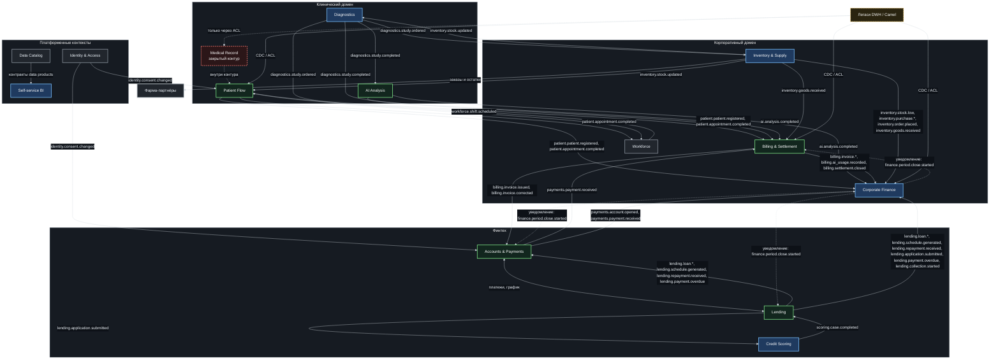

# Bounded contexts — «Будущее 2.0»

Домены выделены по бизнес-возможностям и владельцам данных, а не по текущим таблицам DWH.
Каждый контекст владеет собственной моделью и хранилищем; интеграция — через события и публичные контракты.

**Диаграмма:** [`bounded-contexts.drawio`](bounded-contexts.drawio) — домены, контексты и события между ними.
Mermaid-версия ниже рендерится на GitHub без draw.io.
Диаграмма drawio дана на уровне доменов: рёбра между контейнерами доменов группируют потоки, а блоки
внутри доменов показывают, кто именно публикует и кто получает факты (Diagnostics & AI и Lending & Scoring
объединены с их единственными потребителями). Авторитетный список подписок —
[Context Map](context-map.md) и [матрица подписок](event-storming.md). Уведомление
`finance.period.close.started` указано в блоке Corporate Finance: получают его Billing,
Accounts & Payments и Lending.
Стратегические отношения (OHS, PL, C/S, Conformist, ACL, Partnership, Separate Ways) — на отдельной
[Context Map](context-map.md) с Mermaid-диаграммой и таблицей расшифровки.

## Контексты и их отношения

| Контекст             | Домен         | Тип                | Ответственность                              | Отношение к соседям                                                                                                                                                                                      |
| -------------------- | ------------- | ------------------ | -------------------------------------------- | -------------------------------------------------------------------------------------------------------------------------------------------------------------------------------------------------------- |
| Patient Flow         | Клинический   | Core               | Регистрация пациента, запись, приём, выписка | Open Host для Billing; Customer/Supplier с Workforce                                                                                                                                                     |
| Diagnostics          | Клинический   | Supporting         | Заказ и проведение исследований              | Published Language для AI Analysis                                                                                                                                                                       |
| AI Analysis          | Клинический   | Core (монетизация) | ИИ-заключения, версии моделей                | Conformist к формату исследований                                                                                                                                                                        |
| Medical Record       | Клинический   | Закрытый контур    | Медкарта, история болезни                    | **Не публикуется в аналитику**; обмен с Patient Flow — только внутри клинического домена, наружу не идёт ни одного события                                                                               |
| Accounts & Payments  | Финтех        | Core               | Счета, проводки, платежи                     | Partnership с Lending; с Billing — два встречных потока фактов: потребляет `billing.invoice.issued` и `billing.invoice.corrected` (downstream) и публикует `payments.payment.received` (upstream), без цикла моделей (см. Context Map) |
| Lending              | Финтех        | Core               | Кредитные договоры, график платежей          | Customer/Supplier со Scoring                                                                                                                                                                             |
| Credit Scoring       | Финтех        | Supporting         | Оценка заёмщика                              | Публикует `scoring.case.completed`                                                                                                                                                                       |
| Billing & Settlement | Корпоративный | Core               | Счета за услуги, сверка с клиниками и банком | ACL к DWH-логике; перечень правил и порядок переноса — [`dwh-to-billing-rules.md`](dwh-to-billing-rules.md)                                                                                              |
| Workforce            | Корпоративный | Generic            | Смены, квалификации                          | Поставщик для Patient Flow                                                                                                                                                                               |
| Inventory & Supply   | Корпоративный | Supporting         | Остатки, закупки, фарма-партнёры             | Open Host для партнёров                                                                                                                                                                                  |
| Corporate Finance    | Корпоративный | Supporting         | Управленческая и регуляторная отчётность     | Подписчик событий всех доменов                                                                                                                                                                           |
| Identity & Access    | Платформенный | Generic            | Роли, ABAC                                   | Shared Kernel с платформой                                                                                                                                                                               |
| Data Catalog         | Платформенный | Generic            | Контракты, data products                     | Published Language                                                                                                                                                                                       |
| Self-service BI      | Платформенный | Supporting         | Портал отчётов                               | Потребляет только data products                                                                                                                                                                          |
| Легаси DWH / Camel   | Мост          | Легаси             | Историческая логика                          | Anti-Corruption Layer для всех новых контекстов                                                                                                                                                          |

## Правила границ

1. Чужие БД не читаются — только события и API.
2. Модели не разделяются: каждый контекст хранит свой «Пациент», «Клиент», «Счёт» со своим смыслом.
3. Идентификаторы между контекстами — глобальные ключи (`patient_id`, `customer_id`), без сквозных числовых внешних ключей.
4. Медицинские данные остаются внутри клинического домена; в событиях передаются только идентификаторы и факты,
   необходимые другим доменам (например, «приём завершён», но не диагноз).
