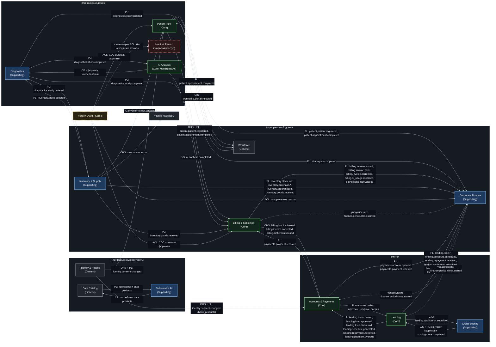

# Context Map — стратегические отношения между bounded contexts

Карта показывает не потоки данных «вообще», а **тип отношения** между контекстами по DDD. Тип отношения
определяет, кто диктует модель, где нужен ACL и что можно менять без согласования.

**Диаграмма:** Mermaid ниже (рендерится на GitHub без draw.io).

Легенда: **OHS** — Open Host Service, **PL** — Published Language, **C/S** — Customer/Supplier,
**CF** — Conformist, **ACL** — Anti-Corruption Layer, **SK** — Shared Kernel, **SW** — Separate Ways,
**Уведомление** — односторонний факт без контрактной зависимости.
Направление стрелок: OHS, PL, C/S и ACL идут от upstream к downstream (по потоку данных), CF — наоборот:
эта стрелка показывает, чью модель принимает conformist (AI Analysis принимает формат Diagnostics,
Self-service BI принимает формат Data Catalog). Уведомление (пунктир) не задаёт контракт и не делает
отправителя upstream. Таблица ниже всегда записана как «upstream → downstream».

## Отношения и что они означают

| Upstream → Downstream | Тип | Что течёт | Кто может меняться без согласования | Защита |
|---|---|---|---|---|
| Identity & Access → Patient Flow | OHS + PL | `identity.consent.changed` | Identity владеет контрактом; Patient Flow — консьюмер | Контракт версионируется, ломающие изменения — только в `.v2` топике |
| Identity & Access → Accounts & Payments | OHS + PL | `identity.consent.changed` (`scope = bank_products`) | Identity владеет контрактом; A&P открывает счёт клиента только при `granted = true` | Отзыв согласия действует немедленно; в финтех-контур приходит только факт согласия |
| Workforce → Patient Flow | C/S | `workforce.shift.scheduled` | Workforce (supplier) планирует смены; Patient Flow заказывает требования | SLA на свежесть, контрактные тесты |
| Patient Flow → Billing & Settlement | OHS + PL | `patient.patient.registered`, `patient.appointment.completed` | Patient Flow (upstream) владеет моделью приёма; Billing — customer | Billing не читает БД Patient Flow |
| Patient Flow → Workforce | PL | `patient.appointment.completed` | Нагрузка персонала; Workforce не меняет модель Patient Flow | Потребляется как факт, без влияния на модель |
| Patient Flow → Corporate Finance | PL | `patient.patient.registered`, `patient.appointment.completed` | Факты потока для метрик | В аналитику идут только идентификаторы и факты |
| Diagnostics → AI Analysis | PL + Conformist | `diagnostics.study.completed`, формат исследования | Diagnostics диктует формат; AI Analysis подстраивается (conformist) | Версия формата в payload, контрактные тесты |
| Diagnostics → Billing & Settlement | PL | `diagnostics.study.completed` | Момент начисления за исследование | Billing не читает БД Diagnostics |
| Diagnostics → Inventory & Supply | PL | `diagnostics.study.ordered` | Резерв расходников под заказанное исследование | Потребляется как факт |
| Diagnostics → Workforce | PL | `diagnostics.study.ordered` | Нагрузка на исследования | Потребляется как факт |
| AI Analysis → Billing & Settlement | C/S | `ai.analysis.completed`, версия модели | AI Analysis (supplier) публикует факт; Billing тарифицирует | Тарифы ИИ версионируются в Billing |
| AI Analysis → Corporate Finance | PL | `ai.analysis.completed` | Выручка по ИИ-услугам | Потребляется как факт |
| Billing → Accounts & Payments | OHS | `billing.invoice.issued`, `billing.invoice.corrected`, `billing.settlement.closed` | Billing владеет счётом; Payments — канал оплаты | ACL не нужен: канонические события |
| Accounts & Payments → Billing | PL | `payments.payment.received` | Payments владеет контрактом платежа; Billing — подписчик и закрывает счёт | Billing не читает БД Payments; идемпотентность по `event_id` |
| Accounts & Payments ↔ Lending | Partnership | Открытие счёта клиента, платежи, графики, выдача средств, сверка | Обе команды совместно меняют контракт | Совместные контрактные тесты, общий релизный цикл |
| Credit Scoring → Lending | C/S + PL | Контракт скоринга, `scoring.case.completed` | Credit Scoring (supplier) владеет моделью скоринга; Lending (customer) задаёт требования к решению | Scoring не знает домена кредита дальше контракта; связь по `application_id` |
| Lending → Credit Scoring | C/S (заявка) | `lending.application.submitted` | Credit Scoring не знает домена кредита дальше заявки | Заявка — единственный вход; ответ приходит по `application_id` |
| Lending → Accounts & Payments | Partnership (в паре AP ↔ Lending) | `lending.loan.created`, `lending.loan.approved`, `lending.loan.disbursed`, `lending.schedule.generated`, `lending.repayment.received`, `lending.payment.overdue` | Выдача средств и их списание — общий процесс | Общий релизный цикл, общие контрактные тесты |
| Billing & Settlement, Accounts & Payments, Lending, Inventory & Supply, Patient Flow, Diagnostics, AI Analysis, Workforce → Corporate Finance | PL | Доменные факты, `lending.application.submitted`, `lending.payment.overdue`, `lending.collection.started`, `payments.account.opened` и `billing.invoice.issued`, `billing.invoice.paid`, `billing.invoice.corrected`, `billing.ai_usage.recorded`, `billing.settlement.closed` | Домены-источники; Corporate Finance — подписчик | Corporate Finance не влияет на операционные модели |
| Inventory & Supply → Billing & Settlement | PL | `inventory.goods.received` | Кредиторская задолженность за приёмку | Потребляется как факт |
| Inventory & Supply → Diagnostics | PL | `inventory.stock.updated` | Доступность расходников | Потребляется как факт |
| Inventory & Supply → Patient Flow | PL | `inventory.stock.updated` | Доступность расходников для приёмов | Потребляется как факт |
| Inventory & Supply → Corporate Finance | PL | `inventory.stock.low`, `inventory.purchase.requested`, `inventory.purchase.approved`, `inventory.order.placed`, `inventory.goods.received` | Домены-источники; Corporate Finance — подписчик | Потребляется как факт |
| Inventory & Supply → партнёры | OHS | Заказы, остатки, статусы | Inventory & Supply владеет контрактом для партнёров | mTLS, отдельный партнёрский шлюз |
| Data Catalog → Self-service BI | PL | Контракты, SLA, метаданные | Data Catalog владеет форматом каталога | BI — conformist, читает только каталог |
| Легаси DWH / Camel → новые контексты | ACL | CDC, легаси-таблицы, коды | Легаси не меняется; ACL переводит в каноническую модель | ACL обязателен, прямых чтений нет |
| Medical Record → аналитический контур | SW (Separate Ways) | — | Только клинический контур | Исходящих рёбер в аналитику нет; обмен с Patient Flow — внутри клинического домена; входящий поток из DWH — только через ACL на этапе миграции исторических данных |
| Corporate Finance → Billing & Settlement, Accounts & Payments, Lending | Уведомление | `finance.period.close.started` | Corporate Finance объявляет начало закрытия периода; модели доменов от этого не меняются | Факт, а не контракт: домены не подписываются на модель Corporate Finance |

## Правила карты

1. **Направление знания.** Upstream диктует контракт, downstream не диктует модель upstream. Если downstream
   не может принять модель — строится ACL, а не «договариваемся о таблице».
2. **ACL только на границе с легаси.** Внутри новых доменов ACL не нужен: контракты канонические.
3. **Partnership — исключение.** Только Accounts & Payments ↔ Lending: у них общий критический процесс
   (деньги), поэтому совместные релизы дешевле, чем ACL.
4. **Billing ↔ Accounts & Payments — два встречных потока фактов.** Billing публикует
   `billing.invoice.issued` и `billing.settlement.closed` (OHS), Accounts — `payments.payment.received` (PL).
   Каждый контекст владеет своим контрактом и не читает БД другого.
5. **Закрытый контур.** Medical Record не имеет исходящих рёбер в аналитический контур — это архитектурное
   свойство, а не настройка прав. Обмен с Patient Flow идёт внутри клинического домена; входящий поток из DWH
   приходит только через ACL на этапе миграции исторических данных.
6. **Уведомление — не контракт.** Пунктирные рёбра (`finance.period.close.started`) не делают отправителя
   upstream и не дают ему диктовать модель: домен реагирует на факт, а не подписывается на контракт.
7. **Corporate Finance — подписчик.** Он получает факты всех доменов (`bounded-contexts.md`), но не влияет на
   операционные модели; платформенные витрины он читает через data products.
8. **Платформенные потребители — вне карты.** Data Platform (lakehouse) и внешние шлюзы
   (партнёрский, регуляторный) не являются bounded contexts и на карте не отображаются; их подписки
   перечислены в [матрице подписок](event-storming.md).
