# Event Storming — целевая событийная архитектура

Уровень: Big Picture (карта процесса) / Process Modeling (моделирование процесса). Легенда: оранжевый — доменное событие, синий — команда,
жёлтый — агрегат, розовый — внешняя система или политика («когда … тогда …»), фиолетовый — проекция для чтения (read model)
(проекция для UI, не публикуемое интеграционное событие).

## Сквозной сценарий 1. Пациент → приём → счёт → оплата → кредит

```mermaid
%%{init: {"theme":"base","themeVariables":{"darkMode":true,"background":"#0d1117","mainBkg":"#161b22","primaryColor":"#1f3a5f","primaryTextColor":"#f0f6fc","primaryBorderColor":"#79c0ff","secondaryColor":"#21262d","tertiaryColor":"#161b22","lineColor":"#d0d7de","textColor":"#f0f6fc","titleColor":"#ffffff","edgeLabelBackground":"#0d1117","clusterBkg":"#161b22","clusterBorder":"#8b949e","nodeBorder":"#79c0ff"}}}%%
flowchart LR
  classDef ev fill:#5c3a0a,stroke:#ffb347,stroke-width:2px,color:#ffffff
  classDef cmd fill:#14306b,stroke:#79a8ff,stroke-width:2px,color:#ffffff
  classDef agg fill:#5a4a00,stroke:#ffe066,stroke-width:2px,color:#ffffff
  classDef pol fill:#5a1a3a,stroke:#ff9ecb,stroke-width:2px,color:#ffffff

  c1[Зарегистрировать пациента]:::cmd --> a1((Patient)):::agg --> e1[Зарегистрирован новый пациент]:::ev
  e1 --> p1{{Открыть клиента финтеха<br/>при наличии согласия — consent}}:::pol --> c2[Открыть счёт]:::cmd --> a2((Account)):::agg --> e2[Счёт открыт]:::ev
  c3[Записать на приём]:::cmd --> a3((Appointment)):::agg --> e3[Приём завершён]:::ev
  e3 --> p2{{Выставить счёт за услугу}}:::pol --> c4[Выставить счёт]:::cmd --> a4((Invoice)):::agg --> e4[Счёт выставлен]:::ev
  e4 --> p3{{Принять платёж}}:::pol --> c5[Провести платёж]:::cmd --> a5((Payment)):::agg --> e5[Платёж получен]:::ev
  e5 --> p4{{Закрыть счёт}}:::pol --> e6[Счёт оплачен]:::ev
  c6[Подать заявку на кредит]:::cmd --> a8((LoanApplication)):::agg --> e9[Заявка на кредит создана]:::ev
  e9 --> p5{{Запустить скоринг}}:::pol --> a7((ScoringCase)):::agg --> e10[Скоринг завершён]:::ev
  e10 --> p6{{Одобрить заявку}}:::pol --> c7[Оформить кредит]:::cmd --> a6((LoanAgreement)):::agg --> e7[Создан кредитный договор]:::ev
  e7 --> p7{{Одобрить кредит}}:::pol --> e11[Кредит одобрен]:::ev
```

Сценарий 1 показывает верхнеуровневую цепочку. Кредитная ветка здесь сокращена: полный путь, где скоринг запускается по `LoanApplication` (`lending.application.submitted`), а `LoanAgreement` создаётся и одобряется после решения (`lending.loan.created`, `lending.loan.approved`), показан в сценарии 3. Имена событий и агрегатов соответствуют `events.md` и `aggregates.md`.

## Сквозной сценарий 2. Исследование → ИИ → заключение

```mermaid
%%{init: {"theme":"base","themeVariables":{"darkMode":true,"background":"#0d1117","mainBkg":"#161b22","primaryColor":"#1f3a5f","primaryTextColor":"#f0f6fc","primaryBorderColor":"#79c0ff","secondaryColor":"#21262d","tertiaryColor":"#161b22","lineColor":"#d0d7de","textColor":"#f0f6fc","titleColor":"#ffffff","edgeLabelBackground":"#0d1117","clusterBkg":"#161b22","clusterBorder":"#8b949e","nodeBorder":"#79c0ff"}}}%%
flowchart LR
  classDef ev fill:#5c3a0a,stroke:#ffb347,stroke-width:2px,color:#ffffff
  classDef cmd fill:#14306b,stroke:#79a8ff,stroke-width:2px,color:#ffffff
  classDef agg fill:#5a4a00,stroke:#ffe066,stroke-width:2px,color:#ffffff
  classDef pol fill:#5a1a3a,stroke:#ff9ecb,stroke-width:2px,color:#ffffff
  classDef rm fill:#3a2a5a,stroke:#c297ff,stroke-width:2px,color:#ffffff

  c1[Назначить исследование]:::cmd --> a1((StudyOrder)):::agg --> e1[Исследование назначено]:::ev
  e1 --> c2[Провести исследование]:::cmd --> a2((Study)):::agg --> e2[Пройдено исследование]:::ev
  e2 --> p1{{Отправить на ИИ-анализ}}:::pol --> c3[Запустить анализ]:::cmd --> a3((AiAnalysis)):::agg --> e3[ИИ-анализ завершён]:::ev
  e3 --> p2{{Уведомить врача}}:::pol --> e4["Заключение доступно врачу<br/>проекция — не публикуется"]:::rm
  e3 --> p3{{Учесть использование для тарификации ИИ}}:::pol --> e5[Использование ИИ зафиксировано]:::ev
```

Событие «Пройдено исследование» (`diagnostics.study.completed`) несёт только идентификаторы (`study_id`,
`patient_id`), тип, время и ссылку на объект-хранилище (`storage_ref`). Само содержимое остаётся
в клиническом контуре и в аналитику не попадает. «Использование ИИ зафиксировано» — это
`billing.ai_usage.recorded` (контекст Billing & Settlement); «Заключение доступно врачу» — проекция для чтения внутри
клинического контура, а не публикуемое интеграционное событие, поэтому его нет в `events.md`.

## Сквозной сценарий 3. Жизненный цикл кредита: заявка → выдача → погашение → просрочка

```mermaid
%%{init: {"theme":"base","themeVariables":{"darkMode":true,"background":"#0d1117","mainBkg":"#161b22","primaryColor":"#1f3a5f","primaryTextColor":"#f0f6fc","primaryBorderColor":"#79c0ff","secondaryColor":"#21262d","tertiaryColor":"#161b22","lineColor":"#d0d7de","textColor":"#f0f6fc","titleColor":"#ffffff","edgeLabelBackground":"#0d1117","clusterBkg":"#161b22","clusterBorder":"#8b949e","nodeBorder":"#79c0ff"}}}%%
flowchart LR
  classDef ev fill:#5c3a0a,stroke:#ffb347,stroke-width:2px,color:#ffffff
  classDef cmd fill:#14306b,stroke:#79a8ff,stroke-width:2px,color:#ffffff
  classDef agg fill:#5a4a00,stroke:#ffe066,stroke-width:2px,color:#ffffff
  classDef pol fill:#5a1a3a,stroke:#ff9ecb,stroke-width:2px,color:#ffffff

  c1[Подать заявку на кредит]:::cmd --> a1((LoanApplication)):::agg --> e1[Заявка на кредит создана]:::ev
  e1 --> p1{{Запустить скоринг}}:::pol --> c2[Запустить скоринг]:::cmd --> a2((ScoringCase)):::agg --> e2[Скоринг завершён]:::ev
  e2 --> p2{{Решение по заявке}}:::pol --> c3[Оформить кредит]:::cmd --> a3((LoanAgreement)):::agg --> e3[Создан кредитный договор]:::ev
  e3 --> p3{{Одобрить кредит}}:::pol --> e4[Кредит одобрен]:::ev
  e4 --> p4{{Выдать средства}}:::pol --> c4[Выдать кредит]:::cmd --> a4((Disbursement)):::agg --> e5[Кредит выдан]:::ev
  e5 --> p5{{Построить график платежей}}:::pol --> a5((RepaymentSchedule)):::agg --> e6[График платежей сформирован]:::ev
  e6 --> p6{{Наступление срока платежа}}:::pol --> c5[Принять платёж по кредиту]:::cmd --> a6((Repayment)):::agg --> e7[Платёж по кредиту получен]:::ev
  e7 --> p7{{Проверить остаток долга}}:::pol --> e8[Кредит закрыт]:::ev
  e6 --> p8{{Срок прошёл, оплаты нет}}:::pol --> e9[Платёж по кредиту просрочен]:::ev
  e9 --> p9{{Просрочка больше N дней}}:::pol --> a7((CollectionCase)):::agg --> e10[Взыскание начато]:::ev
```

Сценарий показывает полный жизненный цикл, включая негативную ветку. Ключевые инварианты:
`LoanAgreement` не меняет условия задним числом (только новая версия договора), `Repayment` идемпотентен
по `idempotency_key`, просрочка рассчитывается от графика, а не от последнего платежа. Заявка и скоринг
партиционируются по `application_id`; начиная с `lending.loan.created` события несут `loan_id` как ключ
партиции — порядок по одной заявке и по одному договору гарантирован.

## Сквозной сценарий 4. Закупка по событию «остаток ниже порога»

Цикл замкнут намеренно: если после поставки остаток всё ещё ниже порога, публикуется новое
`inventory.stock.low`, и политика срабатывает снова. Защита от штормов — порог гистерезиса и
`idempotency_key` заявки (`sku` + период), чтобы одна и та же нехватка не создавала заявки каждую минуту.

## Сквозной сценарий 5. Закрытие отчётного периода

```mermaid
%%{init: {"theme":"base","themeVariables":{"darkMode":true,"background":"#0d1117","mainBkg":"#161b22","primaryColor":"#1f3a5f","primaryTextColor":"#f0f6fc","primaryBorderColor":"#79c0ff","secondaryColor":"#21262d","tertiaryColor":"#161b22","lineColor":"#d0d7de","textColor":"#f0f6fc","titleColor":"#ffffff","edgeLabelBackground":"#0d1117","clusterBkg":"#161b22","clusterBorder":"#8b949e","nodeBorder":"#79c0ff"}}}%%
flowchart LR
  classDef ev fill:#5c3a0a,stroke:#ffb347,stroke-width:2px,color:#ffffff
  classDef cmd fill:#14306b,stroke:#79a8ff,stroke-width:2px,color:#ffffff
  classDef agg fill:#5a4a00,stroke:#ffe066,stroke-width:2px,color:#ffffff
  classDef pol fill:#5a1a3a,stroke:#ff9ecb,stroke-width:2px,color:#ffffff

  c1[Инициировать закрытие периода]:::cmd --> a1((ReportingPeriod)):::agg --> e1[Закрытие периода начато]:::ev
  e1 --> p1{{Собрать факты из доменов}}:::pol --> e2[Факты периода собраны]:::ev
  e2 --> p2{{Сверить расчёты}}:::pol --> c2[Сверить расчёты]:::cmd --> a2((Settlement)):::agg --> e3[Расчёт закрыт]:::ev
  e3 --> p3{{Консолидировать показатели}}:::pol --> a3((Consolidation)):::agg --> e4[Показатели консолидированы]:::ev
  e4 --> p4{{Сформировать пакет отчётности}}:::pol --> a4((ReportPackage)):::agg --> e5[Отчётность сформирована]:::ev
  e5 --> p5{{Отправить регулятору}}:::pol --> e6[Отчётность отправлена]:::ev
```

Отчётный период — агрегат с явными состояниями (`open → collecting → reconciling → closed → reported`).
Пока период не закрыт, исправления идут компенсирующими событиями; после закрытия — только новой
версией отчётного пакета. Это то самое место, где раньше «отчёты строились часами»: теперь консолидация
читает data products и события, а не выполняет тяжёлые join'ы по DWH.

Граница контекста: команда «Сверить расчёты» принадлежит Billing & Settlement (агрегат Settlement), Corporate Finance
не вызывает её напрямую, а подписывается на `billing.settlement.closed` через политику. На диаграмме
поток показан слитно для читаемости; в коде команды не пересекают границу контекста.

## Матрица «источник — подписчики»

Первый столбец — техническое имя события из [`events.md`](events.md), поэтому подписку можно проверить по каталогу
без угадывания. Набор подписок совпадает с рёбрами [Context Map](context-map.md). Два вида исключений
зафиксированы ниже: платформенные потребители (Data Platform) и внешние шлюзы, которых на карте нет, —
и связи типа Partnership, показанные одной двусторонней стрелкой без перечисления событий (состав событий —
в таблице отношений). Всё остальное перечислено на карте явно, включая `billing.invoice.issued`,
`billing.invoice.paid`, `billing.invoice.corrected` и `billing.ai_usage.recorded` — подписки Corporate Finance
на них.

| Событие (`event_type`) | Источник (контекст) | Подписчики | Назначение |
|---|---|---|---|
| `patient.patient.registered` — Зарегистрирован новый пациент | Patient Flow | Billing & Settlement, Corporate Finance | Метрики потока; финтех-счёт открывается по `identity.consent.changed`, а не по регистрации пациента |
| `patient.patient.merged` — Дубликаты профилей объединены | Patient Flow | Data Platform (lakehouse) | Исключение двойного учёта в метриках потока |
| `identity.consent.changed` — Согласие изменено или отозвано | Identity & Access | Patient Flow, Accounts & Payments | Отзыв согласия останавливает передачу данных и открытие финтех-счёта |
| `patient.appointment.completed` — Приём завершён | Patient Flow | Billing & Settlement, Workforce, Corporate Finance | Выставление счёта, нагрузка персонала |
| `workforce.shift.scheduled` — Смена назначена | Workforce | Patient Flow | Доступность врачей |
| `diagnostics.study.ordered` — Исследование назначено | Diagnostics | Inventory & Supply, Workforce | Резерв расходников и оборудования |
| `diagnostics.study.completed` — Пройдено исследование | Diagnostics | AI Analysis, Billing & Settlement | Запуск ИИ, тарификация исследования |
| `ai.analysis.completed` — ИИ-анализ завершён | AI Analysis | Billing & Settlement, Corporate Finance | Монетизация ИИ; заключение врачу — проекция внутри клинического контура, не интеграционное событие |
| `billing.ai_usage.recorded` — Использование ИИ зафиксировано | Billing & Settlement | Corporate Finance, Data Platform (lakehouse) | Монетизация ИИ, выручка по ИИ-услугам |
| `payments.account.opened` — Счёт клиента открыт | Accounts & Payments | Lending, Corporate Finance | Идентификатор счёта для выдачи кредитных средств, учёт клиентов финтеха |
| `billing.invoice.issued` — Счёт за услугу выставлен | Billing & Settlement | Accounts & Payments, Corporate Finance | Ожидание оплаты, дебиторка |
| `payments.payment.received` — Платёж получен | Accounts & Payments | Billing & Settlement, Lending, Corporate Finance | Закрытие счёта, платёжная дисциплина |
| `billing.invoice.paid` — Счёт оплачен | Billing & Settlement | Corporate Finance, Data Platform (lakehouse) | Выручка |
| `billing.invoice.corrected` — Счёт скорректирован | Billing & Settlement | Accounts & Payments, Corporate Finance | Корректировка дебиторки и показателей без изменения прошлых событий |
| `lending.application.submitted` — Заявка на кредит создана | Lending | Credit Scoring, Corporate Finance | Скоринг, воронка заявок |
| `scoring.case.completed` — Скоринг завершён | Credit Scoring | Lending | Решение по кредиту |
| `lending.loan.created` — Создан кредитный договор | Lending | Corporate Finance, Accounts & Payments | График платежей, прогноз портфеля |
| `lending.loan.approved` — Кредит одобрен | Lending | Accounts & Payments, Corporate Finance | Выдача средств, резервы |
| `lending.loan.disbursed` — Кредит выдан, средства зачислены | Lending | Accounts & Payments, Corporate Finance | Зачисление средств, начисление процентов, прогноз выручки |
| `lending.schedule.generated` — График платежей сформирован | Lending | Accounts & Payments, Corporate Finance | Планирование поступлений |
| `lending.repayment.received` — Платёж по кредиту получен | Lending | Accounts & Payments, Corporate Finance | Погашение, обновление резервов, метрики портфеля |
| `lending.payment.overdue` — Платёж по кредиту просрочен | Lending | Corporate Finance, Accounts & Payments | Резервирование, коллекшн |
| `lending.loan.closed` — Кредит полностью погашен и закрыт | Lending | Corporate Finance, Data Platform (lakehouse) | Снятие резерва, качество портфеля |
| `lending.collection.started` — Запущено взыскание | Lending | Corporate Finance | Резерв под обесценение |
| `inventory.stock.low` — Остаток ниже порога | Inventory & Supply | Inventory & Supply (self-policy), партнёры, Corporate Finance | Закупка, заказ; прогноз бюджета снабжения |
| `inventory.purchase.requested` — Создана заявка на закупку | Inventory & Supply | Corporate Finance | Бюджет закупок, прогноз расходов |
| `inventory.purchase.approved` — Заявка на закупку согласована | Inventory & Supply | Corporate Finance | Зафиксирован согласованный бюджет закупки |
| `inventory.order.placed` — Заказ размещён у поставщика | Inventory & Supply | Corporate Finance, партнёрский шлюз | Обязательства, ожидаемые поставки |
| `inventory.goods.received` — Поставка принята на склад | Inventory & Supply | Billing & Settlement, Corporate Finance | Приход на склад, кредиторская задолженность |
| `inventory.stock.updated` — Остаток обновлён | Inventory & Supply | Diagnostics, Patient Flow | Доступность расходников для приёмов |
| `finance.period.close.started` — Начало закрытия отчётного периода | Corporate Finance | Billing & Settlement, Accounts & Payments, Lending — уведомление, не контракт | Заморозка корректировок периода: объявление CF, модели доменов от него не меняются |
| `finance.facts.collected` — Факты периода собраны | Corporate Finance | Data Platform (lakehouse) | Проверка полноты фактов периода перед консолидацией |
| `billing.settlement.closed` — Расчётный период закрыт | Billing & Settlement | Corporate Finance | Закрытие периода |
| `finance.indicators.consolidated` — Показатели консолидированы | Corporate Finance | Data Platform (lakehouse) | Управленческая отчётность, data products |
| `finance.report.generated` — Пакет отчётности сформирован | Corporate Finance | Регуляторный шлюз, Data Platform (lakehouse) | Отправка отчётности, аудит |
| `finance.report.submitted` — Отчётность отправлена регулятору | Corporate Finance | Регуляторный шлюз | Квитанция регулятора (`receipt_id`), аудит отправки |

Три уточнения к матрице:

1. **Data Platform (lakehouse) — не bounded context.** Это платформенный контейнер
   ([`../Task3Advanced/c4-container.md`](../Task3Advanced/c4-container.md)), на Context Map
   ([`context-map.md`](context-map.md)) его нет. Его подписки перечислены только здесь:
   `patient.patient.merged`, `billing.invoice.paid`, `billing.ai_usage.recorded`, `lending.loan.closed`,
   `finance.facts.collected`, `finance.indicators.consolidated`, `finance.report.generated`.
2. **Партнёрский и регуляторный шлюзы** — тоже вне контекстной карты: они получают события через
   ACL-шлюз, а не подписываются на доменные топики (см. «Внешние системы» в [`events.md`](events.md)).
3. **Partnership (Accounts & Payments ↔ Lending)** — на карте это одна двусторонняя стрелка, поэтому
   поток `payments.account.opened` в Lending не виден как отдельное ребро; перечень событий партнёрства
   приведён в таблице отношений [`context-map.md`](context-map.md).

Имена контекстов приведены как в `bounded-contexts.md` и `context-map.md`: «Billing & Settlement»,
«Identity & Access». В `events.md` и `aggregates.md` контекст Billing записан сокращённо — «Billing» —
это тот же контекст.

Подписка «Data Platform (lakehouse)» — это потоковая сборка витрин в lakehouse
([`../Task3Advanced/c4-container.md`](../Task3Advanced/c4-container.md)); Self-service BI витрины не читает
напрямую, а получает только data products, как и на [Context Map](context-map.md).

Два правила, которые матрица отражает явно:

1. **Пациент ≠ клиент банка.** Accounts & Payments не подписан на `patient.patient.registered`: в финтех-контур
   приходит только `identity.consent.changed` с `granted = true`, и уже по нему открывается счёт клиента.
2. **Corporate Finance не диктует модель операционным доменам.** `finance.period.close.started` — уведомление
   о начале закрытия периода, а не контракт: домены не меняют свои модели из-за него, домены-источники остаются
   upstream для Corporate Finance.

## Горячие точки, выявленные в сессии

1. **Двойной смысл «Клиент»:** пациент в клинике и клиент банка — разные агрегаты с разными глобальными
   идентификаторами (`patient_id` и `customer_id`); связывает их только Identity & Access по явному согласию.
2. **Согласие на использование данных:** кто источник истины — Patient Flow или Identity & Access? Решение: Identity &
   Access (агрегат `ConsentPolicy`) — источник истины, остальные контексты подписываются на
   `identity.consent.changed`; согласие не входит в границу агрегата `Patient`.
3. **Порядок событий для расчётов:** сверка требует упорядоченности внутри счёта — ключ партиции `invoice_id`.
4. **Повторная обработка:** все консьюмеры идемпотентны по `event_id`; «ядовитые» сообщения уходят в DLQ.
5. **Корректировки:** исправления не изменяют прошлые события, а публикуют компенсирующие
   (`billing.invoice.corrected`).
