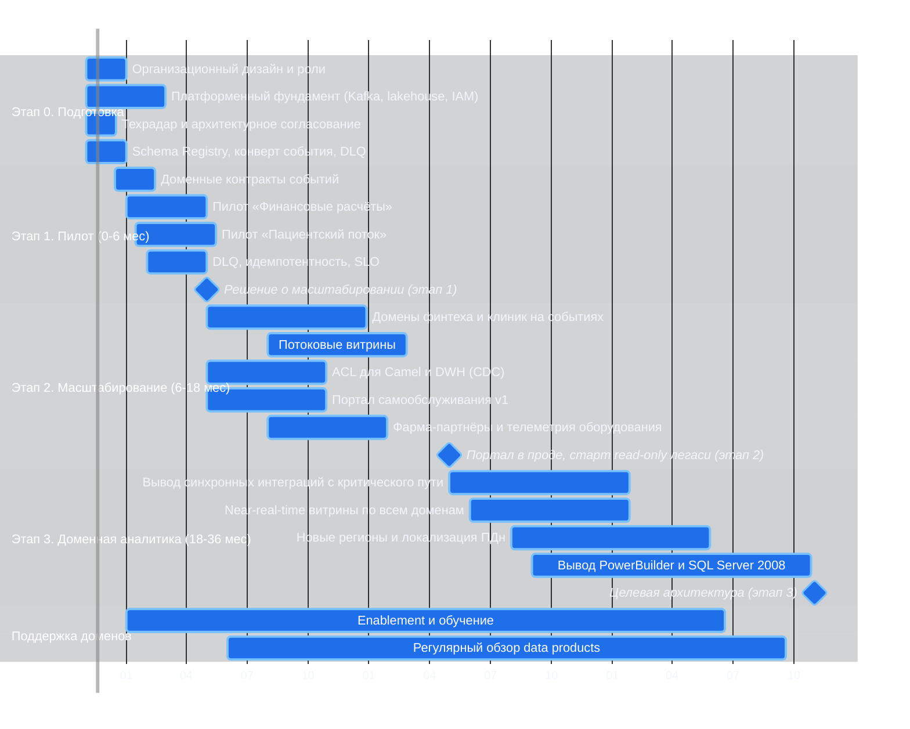

# Стратегический роадмап внедрения Data Mesh, 36 месяцев

Три этапа соответствуют постановке: пилот (0–6), масштабирование (6–18), доменная аналитика и поддержка (18–36).
Каждый этап привязан к бизнес-целям компании и имеет измеримые выходные критерии. Этап 0 — подготовительный
трек: он идёт параллельно с началом пилота, а не последовательно перед ним.

## 1. Обзор по этапам

## 2. Этапы, содержание и критерии выхода

### Этап 0. Подготовка (месяцы 0–2; платформенный фундамент — до месяца 4)

| Работы | Результат |
|---|---|
| Назначить роли, сформировать платформенную команду | Ядро платформенной команды 4–6 человек на старте (растёт до 14 → 18 → 20 FTE по годам, как заложено в `tco-analysis.md`), Data Product Owners в двух пилотных доменах |
| Архитектурное согласование, техрадар | Утверждены границы доменов, радар, TCO |
| Платформенный фундамент | Kafka, lakehouse, IAM/OPA, Terraform-среды доменов |
| Каталог схем и принципы событий | Schema Registry, конверт события, политика DLQ |

Готовность: инфраструктура разворачивается из кода за один прогон pipeline; пилотные домены назначены.
Платформенный фундамент (Kafka, lakehouse, IAM/OPA) по плану занимает 120 дней и продолжается до месяца 4
параллельно с началом пилота; Schema Registry с конвертом события и политикой DLQ разворачивается в Этапе 0
(60 дней) — на Этапе 1 в нём регистрируются уже доменные контракты. Организационная и архитектурная
готовность этапа 0 достигается к месяцу 2.

### Этап 1. Пилот (месяцы 0–6): финансовые расчёты и пациентский поток

| Работы | Результат |
|---|---|
| Финансовые расчёты: события счёта, оплаты, сверки | `billing.invoice.*`, `payments.payment.*`, `billing.settlement.*` в проде; сверка с DWH сходится |
| Пациентский поток: регистрация, приём | `patient.patient.registered`, `patient.appointment.completed`; интерфейс операторов без PowerBuilder на пилотном участке |
| Единые принципы: идемпотентность, доменные контракты, каталог data products | Первые доменные контракты зарегистрированы в Schema Registry; опубликованы 6–8 data products с владельцами и SLA |
| Портал: прототип каталога и конструктора | 20–30 пользователей собирают отчёты самостоятельно |

Критерии выхода этапа 1:
- сверка «DWH ↔ новый контур» без расхождений 10 рабочих дней;
- p95 времени отчёта в портале ≤ 30 с (против часов);
- ≥ 10 отчётов, собранных бизнесом без участия BI-команды;
- ноль инцидентов с медданными;
- TCO пересчитан по фактическому штату доменных команд, BI-аналитиков, DPO и EA: отклонение от модели
  ≤ 15 %; при большем отклонении — обязательный повторный расчёт TCO и решение спонсора программы
  (сокращение объёма работ либо пересмотр сроков вывода легаси).

**Привязка к бизнес-цели:** «архитектурное решение согласовано, границы доменов определены, в доменах запланированы
проекты развития витрины» (промежуточное состояние — 2 месяца) и снижение time-to-report в двух самых болезненных доменах.

### Этап 2. Масштабирование (месяцы 6–18)

| Работы | Результат |
|---|---|
| Подключить критические домены: финтех, кредитование, биллинг, диагностика/ИИ, персонал, снабжение | Каждый домен публикует события и data products по контракту |
| Потоковые витрины | Near-real-time аналитика по 3–5 ключевым срезам |
| ACL-адаптеры Camel и CDC из DWH | Легаси-источники подключены без новой логики; DWH начинает поэтапный переход в read-only (полностью — к 24 мес) |
| Портал самообслуживания v1 для бизнеса | ABAC, семантический слой, конструктор, аудит доступа |
| Фарма-партнёры и телеметрия оборудования | Интеграция фарма-партнёров по контракту Open Host Service (владеет Inventory & Supply) и приём телеметрии мед. техники через Device Telemetry Gateway → Kafka; новых таблиц DWH не появляется |
| FinOps: показ затрат по доменам (showback) | Каждый домен видит свою стоимость |

Базовые ACL-адаптеры (CDC из DWH, Camel) появляются уже на Этапе 1 — без них не поднять тарификацию Billing
(`../Task4Advanced/dwh-to-billing-rules.md`, волна W0); на Этапе 2 они достраиваются до полного покрытия
легаси-источников.

Интеграция фарма-партнёров и приём телеметрии оборудования также относятся к Этапу 2: домен Inventory &
Supply подключается на этом этапе, фарма-партнёры приходят в него по контракту Open Host Service,
телеметрия — через платформенный адаптер Device Telemetry Gateway. На Этапе 3 подключаются новые регионы
(2–3) с локализацией ПДн и расширяется круг партнёров.

Шкала этапов едина для всех документов работы: 0–6 мес (пилот), 6–18 мес (масштабирование),
18–36 мес (доменная аналитика) — этапы 1, 2 и 3 этого роадмапа; этап 0 (0–2 мес, платформенный
фундамент — до месяца 4) идёт параллельно с началом пилота. Фундамент Data Platform (Object Storage +
Iceberg) закладывается на этапе 0, полный lakehouse, портал v1 и потоковые витрины — на этапе 2.
Та же шкала используется в [`../Task3Advanced/c4-container.md`](../Task3Advanced/c4-container.md) и
[`../Task3Advanced/c4-component.md`](../Task3Advanced/c4-component.md).

Критерии выхода этапа 2 (месяц 18; контрольная проверка на месяце 12 — портал v1 в проде):
- ≥ 60% отчётов бизнеса собираются в портале;
- ≥ 8 бизнес-доменов на событийной модели (2 пилотных + 6 новых);
- DWH переводится в read-only по доменам (полностью — к 24 мес), новых процедур не создаётся;
- p95 интерактивного отчёта ≤ 3 с после предагрегатов; лаг потоковых витрин ≤ 5 мин (p95);
- фарма-партнёры подключены по контракту, телеметрия оборудования принимается в Kafka;
- стоимость домена в пределах +25% к плану.

**Привязка к бизнес-цели:** «через год реализован портал самообслуживания, бизнес-пользователи работают в новой
архитектуре, допускается временное сохранение легаси в отдельных доменах».

### Этап 3. Доменная аналитика и поддержка (месяцы 18–36)

| Работы | Результат |
|---|---|
| Отказ от точечных синхронных интеграций на критическом пути | Только события и API доменов |
| Потоковая аналитика по всем доменам | Замена batch там, где нужен near-real-time |
| Новые регионы (2–3) и расширение круга партнёров | Региональные контуры, локализация ПДн, партнёрские топики с mTLS |
| Вывод PowerBuilder и SQL Server 2008 | Архив, отключение, экономия на лицензиях и поддержке |
| Поддержка доменов как штатный процесс | Регулярный обзор data products, аттестация доступа |

Критерии выхода этапа 3 (месяц 36):
- 100% целевых бизнес-доменов (8) на событийной модели;
- DWH и Camel — только архив/мосты либо отключены;
- ≥ 80% отчётов собираются бизнесом; медиана time-to-report ≤ 1 день;
- стоимость соответствует модели: полный TCO года 3 около 491 млн, из них регулярные затраты около 461 млн, остальное — завершающая часть разовой миграции (30 млн); доменные команды и BI — по фактическому штату, а не «вне TCO» (см. `tco-analysis.md` §4);
- 2–3 региона запущены.

**Привязка к бизнес-цели:** масштабирование по продуктам, географии и данным; слабосвязанная событийная платформа
как целевое состояние.

## 3. Ресурсная загрузка по этапам

Платформенная команда учтена в TCO (`tco-analysis.md` §4, строка «Сопровождение: платформа + легаси»:
14 → 18 → 20 FTE). Доменные команды, BI-аналитики, Security/DPO доменов и Enterprise Architect — тоже входят
в TCO, отдельной строкой «Сопровождение: доменные команды, BI-аналитики, DPO, EA» (5 / 11 / 12 FTE и
2 / 3,5 / 4 FTE по доменным ролям). Раньше эти роли считались «вне TCO», что делало сравнение с as-is
несимметричным: в as-is вся доменная работа сидела внутри «Сопровождение (≈25 FTE)», а в to-be она исчезла
из расчёта. Теперь периметр одинаков с обеих сторон, и плата за data mesh (+200 млн за три года) видна
явно, а не прячется в «бюджетах доменов».

В таблице ниже FTE указаны **на конец этапа**, а в TCO — **среднегодовой штат**: год 1 охватывает Этап 1
и первые месяцы Этапа 2, поэтому 14 FTE в год 1 — это среднее по году, тогда как на конец Этапа 1 (месяц 6)
команда ещё меньше. Интерполяция «на конец этапа → среднегодовой штат» приведена в
[`tco-analysis.md`](tco-analysis.md) §1. Специалисты могут совмещаться между ролями.

| Роль | Этап 0 (0–2 мес) | Этап 1 (0–6 мес) | Этап 2 (6–18 мес) | Этап 3 (18–36 мес) | Чем занимается |
|---|---:|---:|---:|---:|---|
| Платформенная команда (в TCO) | 6 | 8 | 18 | 20 | Kafka, lakehouse, каталог, IAM/OPA, наблюдаемость, CI/CD |
| — Data Engineer | 2 | 3 | 7 | 8 | Коннекторы, CDC, потоковые витрины, контракты |
| — Platform / SRE | 2 | 2,5 | 6 | 7 | Кластеры, SLO, DLQ, инциденты |
| — Security Engineer | 1 | 1 | 2 | 2 | OPA, изоляция контуров, DLP, аттестация |
| — Tech Lead платформы | 1 | 1 | 2 | 2 | Архитектура платформы, ревью, найм |
| — FinOps | — | 0,5 | 1 | 1 | Бюджеты, showback, lifecycle |
| Enterprise Architect | 1 | 0,5 | 1 | 1 | Границы доменов, техрадар, контрольные точки этапов |
| Data Product Owners | 1 (2 × 0,5) | 1 (2 × 0,5) | 3 (6 × 0,5) | 4 (8 × 0,5) | Ценность и SLA продуктов, приоритеты домена |
| Доменные команды (бюджеты доменов) | — | 6 (2 пилотных × 3) | 12 (6 новых × 2; всего 8) | 12 (8 доменов в поддержке × 1,5) | Доменные сервисы, ACL, data products |
| BI-аналитики | 1 | 2 | 4 | 4 | Семантический слой, обучение, портал |
| Security/DPO доменов | 0,5 | 0,5 | 2 | 2 | Согласования, политики, инциденты |
| **Итого (округлённо)** | **~10** | **~18** | **~40** | **~43** | |

Здесь «домен» — бизнес-домен (клиники, финтех, аптека, корпоративные финансы и т. д.), а не bounded context;
в `Task4Advanced` выделено 14 bounded contexts (плюс мост «Легаси DWH / Camel»), часть из них приходится
на один бизнес-домен.

Как это читается по активностям:

- **Пилот (0–6 мес):** 6 инженеров доменных команд (по 3 на «Финансовые расчёты» и «Пациентский поток»),
  2 Data Product Owner по 0,5 FTE, 8 FTE платформы. Этого достаточно, чтобы поднять Kafka, lakehouse,
  каталог и два потока, не распыляясь на остальные домены.
- **Масштабирование (6–18 мес):** +4 Data Engineer и +2 BI-аналитика (в составе платформы — 18 FTE),
  домены подключаются по 2 инженера; на этом этапе появляются потоковые витрины и портал v1.
- **Доменная аналитика (18–36 мес):** платформа 20 FTE, доменные команды переходят на 1,5 FTE на домен
  (сопровождение вместо запуска), BI-аналитики остаются 4 FTE — они ведут семантический слой и обучение.
- **Легаси-команда** отдельно: 15 → 10 → 4 FTE по годам (в TCO), к 36-му месяцу — только архив и мосты.

## 4. Роли и ответственность (RACI по ключевым активностям)

| Роль | Ключевая ответственность | Что решает | Что не делает |
|---|---|---|---|
| **Data Product Owner** (в каждом домене) | Ценность data product, приоритеты, SLA, бюджет домена | Какие продукты и с какой свежестью нужны бизнесу | Не пишет ETL-код и не администрирует платформу |
| **Data Engineer** (домен + платформа) | Пайплайны, контракты событий, качество данных, публикация data product | Технические решения внутри домена | Не определяет бизнес-метрики |
| **BI-аналитик** | Семантическая модель, витрины, обучение пользователей, контроль корректности отчётов | Как считаются метрики | Не владеет операционными данными |
| Enterprise Architect | Границы доменов, паттерны, техрадар, контроль деградации | Архитектурные исключения | Не ведёт операционную поддержку |
| Платформенная команда (Platform/SRE) | Kafka, lakehouse, каталог, IAM, наблюдаемость, FinOps | Технологический стандарт | Не разрабатывает бизнес-логику доменов |
| CISO / Security | ABAC-политики, изоляция контуров, соответствие регуляторам | Доступ к чувствительным данным | Не определяет бизнес-приоритеты |
| Domain Lead (владелец бизнес-направления) | Приоритет домена, приёмка data products | Инвестиции в домен | Не управляет платформой |

| Активность | Data Product Owner | Data Engineer | BI-аналитик | Platform | Enterprise Architect | CISO |
|---|---|---|---|---|---|---|
| Определение data product | A | R | C | C | C | C |
| Публикация контракта события | C | R | I | A | C | C |
| Потоковая витрина | A | R | R | C | I | I |
| Семантический слой и метрики | C | C | A/R | I | I | I |
| ABAC-политики | C | C | I | R | C | A |
| Онбординг нового домена | A | R | C | R | C | C |
| Финансовая прозрачность домена | A | C | I | R | I | I |

A — отвечает за результат, R — исполняет, C — консультирует, I — информируется.

## 5. Привязка этапов к бизнес-целям

| Бизнес-цель | Этап 1 | Этап 2 | Этап 3 |
|---|---|---|---|
| Промежуточное состояние (2 мес) | Границы доменов, проекты витрин | — | — |
| Финальное состояние (1 год) | Пилот портала | Портал в проде, бизнес работает | — |
| Продукты: финтех, медицина, монетизация ИИ | Финансовые расчёты в пилоте | Кредитование, ИИ-тарификация и интеграция фарма-партнёров на событиях | Новые продукты на готовой платформе |
| География: 2–3 региона | — | Подготовка мультирегиональности: контуры регионов, локализация ПДн | Запуск 2–3 регионов |
| Данные: рост источников, near-real-time | Контракты и каталог | Потоковые витрины | Потоковая аналитика по всем доменам |
| Слабосвязанная событийная платформа (3 года) | Шина событий и принципы | ACL и вывод DWH из критического пути | Отказ от синхронных интеграций |

## 6. Управление и контрольные точки

- **Ежемесячно:** архитектурный совет — риск-реестр (`Task3Advanced`), техрадар, стоимость доменов.
- **Ежеквартально:** обзор портфеля data products (закрытие неиспользуемых), аттестация доступа.
- **Контрольные точки этапов** (месяцы 6, 18, 36; контрольная проверка портала на месяце 12): решение продолжать/скорректировать принимает спонсор программы совместно с
  Domain Leads. Если этап не пройден — масштабирование приостанавливается, но легаси не отключается.
- **Метрики успеха:** time-to-report (медиана), доля отчётов, собранных бизнесом, число доменов на событиях,
  стоимость на ТБ, число инцидентов с качеством данных, доля трафика на near-real-time.
- **Коммуникация:** ежемесячный дайджест для доменов, «демо-дни» data products, enablement-программа для аналитиков.
