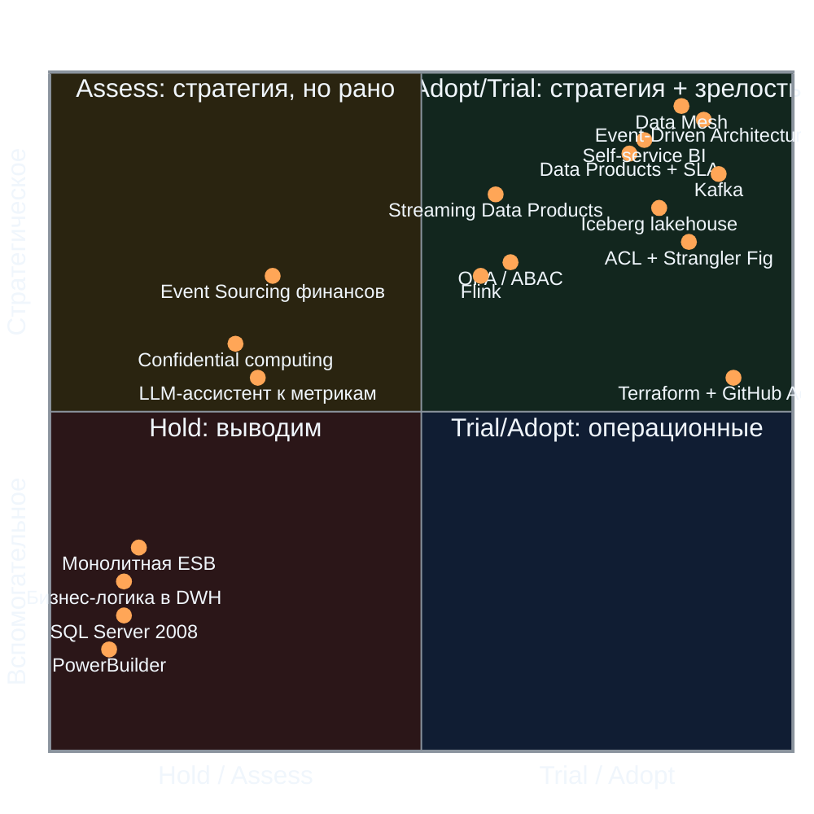

# Расширенный технологический радар «Будущее 2.0»

Радар охватывает технологии и архитектурные паттерны. Статусы: **Adopt** — применяем по умолчанию,
**Trial** — внедряем в пилотах и на отдельных доменах, **Assess** — изучаем, готовим PoC, **Hold** — не начинаем новое
и выводим существующее.
В таблицах ниже элементы сгруппированы для читаемости: например, все языки — одной строкой, поэтому строк
меньше, чем позиций радара.
Колонка «Риск» указывает, чем рискует выбор технологии: это идентификаторы из реестра рисков
`Task3Advanced/risk-map.md` — A — архитектурные, O — организационные, T — технологические,
S — безопасность и регуляторика.

## Диаграмма

На диаграмме — 18 ключевых элементов для презентации. Полный радар — в таблицах ниже.

## Adopt

| Категория  | Элемент                                        | Тип            | Обоснование                                                                 | Риск                                                              |
| ---------- | ---------------------------------------------- | -------------- | --------------------------------------------------------------------------- | ----------------------------------------------------------------- |
| Паттерны   | Domain-Driven Design                           | Паттерн        | Границы доменов и владение данными                                          | A4 — размытие границ доменов                                      |
| Паттерны   | Event-Driven Architecture                      | Паттерн        | Целевая слабосвязанная платформа; основа near-real-time                     | A3 — эволюция схем ломает консьюмеров                             |
| Паттерны   | Data Mesh                                      | Паттерн        | Домены владеют data products; масштабирование без центрального узкого места | A6 — vendor lock-in; O2 — сопротивление доменов                   |
| Паттерны   | Self-service BI                                | Паттерн        | Требование бизнеса: отчёты и конструктор без участия BI-команды             | A5 — портал как узкое место; O3 — выгрузки без SLA                |
| Паттерны   | Transactional Outbox                           | Паттерн        | Атомарность записи в БД и публикации события                                | A3 — эволюция контрактов; T3 — потеря событий                     |
| Паттерны   | Anti-Corruption Layer                          | Паттерн        | Изоляция Camel и DWH от доменной модели                                     | A2 — легаси-логика не перенесена в домены                         |
| Паттерны   | Strangler Fig                                  | Паттерн        | Миграция без остановки бизнеса                                              | A1 — двойная запись в период миграции                             |
| Паттерны   | Schema Registry / contract-first               | Паттерн        | Совместимость контрактов событий                                            | A3 — эволюция схем; O5 — рост вне контрактов                      |
| Паттерны   | Data Product с SLA и владельцем                | Паттерн        | Единица поставки данных                                                     | O3 — нет владельца и SLA; O6 — нет метрик успеха                  |
| Технологии | Golang, Java 21, Python 3.12, TypeScript/React | Языки          | Существующие компетенции + портал                                           | O1 — нехватка инженеров                                           |
| Технологии | PostgreSQL 16                                  | БД             | Операционные хранилища доменов                                              | A4 — доступ к чужим БД в обход границ                             |
| Технологии | Apache Kafka                                   | Платформа      | Шина событий                                                                | T3 — сбой Kafka и потеря событий                                  |
| Технологии | Apache Iceberg + Trino                         | Данные         | Открытый lakehouse и SQL-доступ                                             | A6 — vendor lock-in; T1 — рост стоимости облака                   |
| Технологии | Debezium                                       | Данные         | CDC из DWH                                                                  | A1 — двойная запись при CDC; T5 — качество данных из DWH          |
| Технологии | dbt                                            | Данные         | Трансформации и метрики как код                                             | O5 — логика вне контрактов; T5 — неполные данные                  |
| Технологии | Terraform, Kubernetes, GitHub Actions          | Инфраструктура | Воспроизводимые среды доменов (см. Task1Advanced, Task2Advanced)            | T1 — рост стоимости облака; O1 — нехватка платформенных инженеров |
| Технологии | OpenTelemetry + Grafana, Keycloak              | Платформа      | Наблюдаемость, SSO                                                          | S4 — избыточные права в ABAC; A5 — производительность портала     |

## Trial

| Категория  | Элемент                                         | Тип            | Обоснование                                                                                                                            | Риск                                                               |
| ---------- | ----------------------------------------------- | -------------- | -------------------------------------------------------------------------------------------------------------------------------------- | ------------------------------------------------------------------ |
| Паттерны   | Streaming Data Products                         | Паттерн        | Потоковые витрины на этапе 6–18 мес                                                                                                    | A7 — near-real-time не достигается; T5 — качество данных           |
| Паттерны   | Federated Computational Governance              | Паттерн        | Политики как код, исполняемые в доменах                                                                                                | O2 — сопротивление доменов; O5 — рост вне контрактов               |
| Паттерны   | ABAC / Policy-as-Code (OPA)                     | Паттерн        | Доступ по строкам и столбцам в портале                                                                                                 | S4 — избыточные права; S2 — доступ к финансовым данным в lakehouse |
| Паттерны   | Data Contracts as code                          | Паттерн        | Проверка контрактов в CI                                                                                                               | A3 — эволюция схем; O5 — обход контрактов                          |
| Паттерны   | FinOps showback по доменам                      | Паттерн        | Прозрачность стоимости: показ затрат по домену (showback)                                                                              | O2 — домены не признают владение данными; T1 — рост стоимости      |
| Технологии | Apache Flink                                    | Потоки         | Потоковые витрины                                                                                                                      | T3 — потеря событий; O1 — нехватка инженеров                       |
| Технологии | ClickHouse                                      | Данные         | Быстрые срезы для портала                                                                                                              | A6 — vendor lock-in; T1 — стоимость                                |
| Технологии | DataHub, OpenLineage                            | Данные         | Каталог и происхождение данных                                                                                                         | O3 — нет владельца и SLA; A5 — нагрузка на портал                  |
| Технологии | Cube.js                                         | BI             | Семантический слой                                                                                                                     | A5 — портал как узкое место; O3 — качество витрин                  |
| Технологии | Feature store                                   | ИИ             | Признаки для ИИ-сервисов                                                                                                               | T5 — неполные данные; O1 — нехватка инженеров                      |
| Технологии | Multi-region active-passive                     | Инфраструктура | Новые регионы и резидентность                                                                                                          | S3 — локализация ПДн; T1 — стоимость                               |
| Технологии | Power BI                                        | BI             | Остаётся для регламентной отчётности, не для кастомных витрин. Trial означает ограниченное применение с планом сокращения кастомизаций | O4 — потеря знаний PowerBuilder-разработчиков; A2 — легаси-логика  |
| Технологии | C4 model as code (Structurizr DSL / Mermaid C4) | Платформа      | Диаграммы в Git как код; сейчас — draw.io + Markdown-описание (Task 3), переход на DSL — в бэклоге                                     | A4 — размытие границ доменов                                       |

## Assess

| Категория  | Элемент                                              | Тип            | Обоснование                                                      | Риск                                                                       |
| ---------- | ---------------------------------------------------- | -------------- | ---------------------------------------------------------------- | -------------------------------------------------------------------------- |
| Паттерны   | Event Sourcing для финансового ядра                  | Паттерн        | Воспроизводимость проводок; высокая сложность                    | T2 — ошибки биллинга и сверки в период двойного учёта; A1 — двойная запись |
| Паттерны   | GraphQL Federation                                   | Паттерн        | Альтернатива BFF при росте портала                               | A4 — обход границ доменов; O5 — рост вне контрактов                        |
| Технологии | Iceberg REST Catalog / Polaris                       | Данные         | Вендор-нейтральный каталог                                       | A6 — vendor lock-in на каталог                                             |
| Технологии | Delta / Hudi interop                                 | Данные         | Совместимость форматов                                           | A6 — vendor lock-in; T1 — стоимость                                        |
| Технологии | Confidential computing                               | Безопасность   | Чувствительные данные в облаке                                   | S1 — медданные вне контура; S2 — консолидация в lakehouse                  |
| Технологии | Vector search для клинических знаний                 | ИИ             | Векторный поиск по клиническим протоколам (без данных пациентов) | S1 — медданные в аналитическом контуре; S3 — локализация                   |
| Технологии | LLM-ассистент к семантическому слою                  | BI             | Вопросы к метрикам естественным языком                           | S2 — чувствительные данные в запросах к внешней модели                     |
| Паттерны   | Data Mesh на уровне самостоятельных доменов-компаний | Паттерн        | Требует зрелых владельцев данных                                 | O2 — сопротивление доменов; O1 — нехватка Data Engineer                    |
| Технологии | WASM-политики на edge                                | Платформа      | Единые политики для нескольких регионов                          | S4 — избыточные права; S3 — локализация ПДн                                |
| Технологии | Private 5G для телеметрии оборудования               | Инфраструктура | Поток данных с мед. техники                                      | S1 — периметр телеметрии расширяется за пределы контура                    |

## Hold

| Категория  | Элемент                                     | Тип            | Действие                                                                                                                     | Риск                                                                |
| ---------- | ------------------------------------------- | -------------- | ---------------------------------------------------------------------------------------------------------------------------- | ------------------------------------------------------------------- |
| Технологии | Microsoft SQL Server 2008                   | Данные         | Read-only 18–24 мес по доменам, вывод к 30–36 мес                                                                            | T4 — нет поддержки вендора; A2 — легаси-логика вне доменов          |
| Технологии | PowerBuilder                                | Интерфейс      | Замена интерфейса операторов на доменные UI                                                                                  | O4 — потеря знаний разработчиков                                    |
| Технологии | Расширение on-prem DWH                      | Инфраструктура | Новых инвестиций нет                                                                                                         | T1 — рост стоимости; A6 — привязка к собственному железу            |
| Технологии | Excel как система учёта                     | BI             | Перенос в портал                                                                                                             | T5 — некачественные данные                                          |
| Технологии | Форматы данных без экспорта                 | Данные         | Только открытые форматы                                                                                                      | A2 — легаси-логика не переносится; O5 — рост вне контрактов         |
| Технологии | Apache Camel                                | Интеграция     | **Hold с исключением:** допускается только как ACL-адаптер на период миграции; новых потоков, маршрутов и логики не начинаем | A2 — легаси-логика не перенесена; O4 — потеря знаний по интеграциям |
| Паттерны   | Центральная ESB как единственная интеграция | Паттерн        | Только ACL-мост                                                                                                              | O5 — домены добавляют интеграции вне контрактов; A2                 |
| Паттерны   | Синхронные интеграции на критическом пути   | Паттерн        | Заменяются событиями к 18–36 мес                                                                                             | A4 — домены зависят от чужих БД                                     |
| Паттерны   | Логика в хранимых процедурах DWH            | Паттерн        | Перенос в домены                                                                                                             | A2 — легаси-логика; O4 — потеря знаний                              |
| Паттерны   | ETL под каждый отчёт                        | Паттерн        | Заменяется data products                                                                                                     | O3 — выгрузки без SLA; A5 — нагрузка на портал                      |
| Паттерны   | Монолитная схема DWH для всех доменов       | Паттерн        | Противоречит Data Mesh                                                                                                       | A4 — границы доменов; A6 — vendor lock-in                           |

## Обоснование ключевых решений

- **Data Mesh — Adopt.** Компании нужно развивать направления независимо; централизованный DWH
  уже является узким местом (отчёты часами). Внедрение поэтапное: пилот в 1–2 доменах (см. `roadmap.md`).
- **Kafka и Iceberg — открытые стандарты.** Снижают риск вендорной привязки; облачный managed-сервис допустим,
  данные остаются переносимыми.
- **Power BI — Trial, не Hold.** В компании есть накопленная экспертиза и регламентные отчёты; кастомизации поверх DWH
  сокращаем, но не отказываемся без необходимости. Формулировка в `c4-container.md` приведена к той же классификации:
  инструмент остаётся для регламентных отчётов, но применение ограничено (новые витрины не строятся, кастомизации
  поверх DWH сокращаются), план сокращения — этап 2.
- **SQL Server 2008 — Hold.** Нет вендорской поддержки; это риск безопасности для финансовых данных (см. T4 в `Task3Advanced`).
- **Event Sourcing — Assess.** Полезен для финансового ядра, но требует зрелости команд; сначала событийная интеграция.
- **Apache Camel — Hold с исключением.** PoC не нужен: технология уже работает. Новых маршрутов и логики
  не начинаем, существующие маршруты используются только как ACL-адаптер легаси → события до вывода (30–36 мес).
- **Медицинские данные.** Ни одна технология радара не включает медкарты в аналитический контур.
